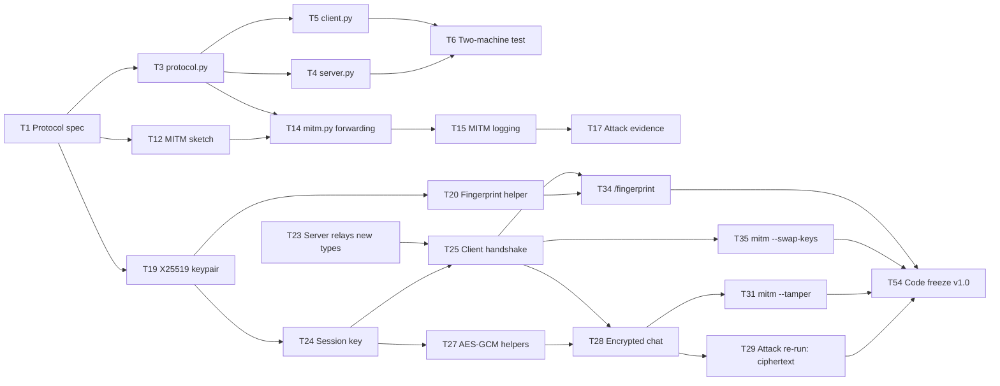

# Roadmap: how we build E2EE Chat

This is the **how**: what to build, in what order, and how we know it's done.
The **status** (owner, hours, To Do / Done) lives in the backlog workbook in our OneDrive folder:
`378_End-to-End-Encryption/E2EEChat_Sprint1_ProductBacklog.xlsx`. Task IDs (T1, T2, ...) are the same in both places.

---

## 1. Start here

**What we're building:** a terminal chat app, an attack on it, and the defense that stops the attack.

**The demo story (this is what the grade rides on):**

1. **Plaintext chat works**, and our MITM reads every message. Wireshark shows the text too.
2. **We turn on end-to-end encryption.** The same attack now captures only gibberish.
3. **The MITM swaps public keys** and can read the chat again: encryption alone isn't enough.
4. **We compare key fingerprints.** They don't match, so the swap is caught.

Tamper detection is a bonus moment: if the MITM flips one byte, the receiver rejects the message.

**Key dates:**

| Date | What |
|---|---|
| Wed Nov 11 | Kickoff. Protocol spec (T1) drafted. |
| Mon Nov 16 | **Code freeze.** Everything merged to `main`, tagged `v1.0`. |
| Nov 17-19 | Report, slides, rehearsal, office-hours demo. |
| **Fri Nov 20, 11:59 PM** | **Everything submitted.** |

**Tech:** Python 3.12+, TCP sockets, the `cryptography` library (X25519, HKDF-SHA256, AES-256-GCM), pytest, ruff.

---

## 2. Who owns what

| Role | Person | Owns |
|---|---|---|
| PM + server | Nathan | Repo, `server.py`, integration, code freeze, demo booking, rehearsal |
| Crypto lead | _TBD_ | Protocol spec, `protocol.py`, `crypto_utils.py`, threat model, QC |
| Attack lead | _TBD_ | `client.py`, `mitm.py`, all attack runs and evidence |
| Docs lead | _TBD_ | README sections, team docs, architecture diagram, report assembly, slides, backup video |

Everyone writes their own report section and presents their own part.

---

## 3. What blocks what

Start with anything that has no arrows coming into it. Everything else waits for the boxes before it.



**Can start on day 1, no waiting:** T1 (protocol spec), T2 (repo), T13 (threat model), T41 (report skeleton), T51 (book demo), T52 (team docs).

**The critical path** is T1 → T3 → T19/T24 → T25 → T28. If any of these slip, everything after them slips, so ask for help early.

---

## 4. Use cases: how to build each one

Each use case lists its stories and tasks, the files involved, the steps, how we know it's done, and what evidence to save.
Suggested commands and ports are placeholders until the protocol spec (T1) confirms them.

### UC-1: Send and receive a chat message (US-1)

**Goal:** two users chat through our relay server in plaintext. This is the "before" picture that everything else attacks and defends.

**Files:** `e2ee_chat/protocol.py`, `e2ee_chat/server.py`, `e2ee_chat/client.py`

**Steps:**

1. **T1 Protocol spec (Crypto lead):** write it in OneDrive `02_Design`.
   - Framing: a 4-byte length prefix + JSON.
   - Every message type for the whole project: `register`, `chat`, `error`, `pubkey`, `encrypted`.
   - Handshake order, default port, and one example of each message.
   - **The team signs off before anyone codes against it.**
2. **T3 `protocol.py` (Crypto lead):** `send_msg(sock, dict)` and `recv_msg(sock) -> dict`, handling messages that arrive split across several TCP reads.
3. **T4 `server.py` (Nathan):** accept many clients (one thread each), register usernames, relay `chat` messages to the named user, clean up on disconnect. The server never needs to read the message text.
4. **T5 `client.py` (Attack lead):** host/port arguments, username prompt, a send loop plus a receive thread, and `/quit`.
5. **T7 Error handling (Nathan):** server down, recipient offline, duplicate username, malformed JSON. Show a clear message and never crash.
6. **T6 Two-machine test (Attack lead):** use a phone hotspot or our own router, and write down the firewall/IP steps for Windows and macOS. Fallback: two terminals on one laptop.
7. **T8 README run steps (Docs lead):** someone who didn't write the code follows it and succeeds.

**Done when:**
- [ ] Two clients register different usernames and messages appear on the other side within 1 second.
- [ ] The server relays the spec's length-prefixed JSON.
- [ ] Offline recipient or dead server: clear error, no crash.
- [ ] A teammate runs it from the README alone.

**Tests:** `tests/test_protocol.py`, which checks that a message split across reads still arrives whole. Add a server/client test with two local sockets.

**Evidence (T9):** a screenshot of the plaintext chat working, saved in `05_Evidence`.

---

### UC-2: Intercept chat traffic as a man-in-the-middle (US-2)

**Goal:** prove plaintext chat is readable in transit. This is the "perform an attack" half of the assignment.

**Files:** `e2ee_chat/mitm.py`, `intercepted.log` (gitignored, never committed)

**How it works:** the clients connect to the MITM's port instead of the server's. In a real attack, ARP or DNS spoofing would trick them into that; we point them there directly and say so in the report. The MITM forwards everything both ways, so the chat still works, but it logs every message.

**Steps:**

1. **T13 Threat model (Crypto lead):** who the attacker is, what they can see and change, and what's out of scope. This becomes a report section.
2. **T12 MITM sketch (Attack lead):** one page on how `mitm.py` listens, forwards and logs. The team reviews it before coding.
3. **T14 Forwarding (Attack lead):** listen on its own port and, for each client, open a connection to the real server. One thread per direction.
4. **T15 Logging (Attack lead):** decode each frame and write the timestamp, direction, sender and text to `intercepted.log`, plus a live print to the attacker's terminal.
5. **T16 README "Running the attack" (Docs lead):** start order, ports, where the log goes, and the ethics rule.
6. **T17 Attack run + Wireshark (Attack lead):** capture the chat in Wireshark and show the message text in the packets.

**Done when:**
- [ ] Clients routed through the MITM chat normally and can't tell.
- [ ] `intercepted.log` shows the conversation in readable plaintext.
- [ ] A Wireshark capture shows the message text.

**Evidence (T17):** screenshots of the attacker terminal, `intercepted.log` and Wireshark, saved in `05_Evidence`.

---

### UC-3: Set up a secure session (US-3, US-4)

**Goal:** both clients end up with the same secret key, and the server and MITM can't compute it.

**Files:** `e2ee_chat/crypto_utils.py`, plus handshake changes in `client.py` and `server.py`. Keys go in `keys/`, which is gitignored.

**How it works:**
1. Each client has an X25519 key pair: a private key that never leaves the laptop and a public key it shares.
2. The clients swap public keys through the server.
3. Each side combines its own private key with the other's public key (Diffie-Hellman), then runs HKDF-SHA256. Both get the same AES-256 key, and that key never crosses the network.

**Steps:**

1. **T19 Key pair (Crypto lead):** generate, save and load an X25519 key pair; reuse it on later starts.
2. **T20 Fingerprint helper (Crypto lead):** export the public key as base64 and compute its SHA-256 fingerprint in grouped hex. US-7 needs this.
3. **T23 Server relays new types (Nathan):** forward `pubkey` and `encrypted` messages unchanged.
4. **T24 Session key (Crypto lead):** X25519 exchange + HKDF-SHA256 → 32-byte AES key. This is the hardest crypto task, so start early.
5. **T25 Client handshake (Attack lead):** send our public key on connect, receive the peer's, derive the session key, and block chat until that's done.
6. **T26 Debug mode (Crypto lead):** print a short hash of the session key on both clients so we can see they match.
7. **T21 No private keys on the wire (Nathan):** run a session through the MITM and search `intercepted.log`.

**Done when:**
- [ ] A key pair is created on first start and reused after.
- [ ] Only public keys appear on the wire.
- [ ] Both clients show the same session-key hash in debug mode.

**Tests:** `tests/test_crypto_utils.py`, which checks that both sides derive the same key and that key save/load round-trips. `tests/test_crypto_lib.py` already shows the pattern.

**Evidence:** a screenshot of matching debug hashes.

---

### UC-4: Send and receive an encrypted message (US-5, US-6)

**Goal:** the same attack from UC-2 now captures only ciphertext, and a tampered message is rejected. This is the "stop an attack" half.

**Files:** `crypto_utils.py`, `client.py`, `mitm.py --tamper`

**Steps:**

1. **T27 Encrypt/decrypt helpers (Crypto lead):** AES-256-GCM with a **fresh random 12-byte nonce for every message** (never reuse one) and base64 for transport.
2. **T28 Encrypted chat (Attack lead):** the client sends and receives `encrypted` messages instead of `chat`.
3. **T29 Attack re-run (Attack lead):** repeat UC-2 against the encrypted build. The log and Wireshark should show only base64 noise. Make a before/after side-by-side screenshot, which is our best slide.
4. **T31 `mitm.py --tamper` (Attack lead):** flip one byte of the ciphertext before forwarding.
5. **T32 Reject tampered messages (Attack lead):** catch `InvalidTag`, show "message failed integrity check" and drop the message.

**Done when:**
- [ ] The recipient sees the exact original text.
- [ ] `intercepted.log` and Wireshark contain no readable words.
- [ ] A tampered message is rejected; untouched messages still arrive.

**Tests:** encrypt → decrypt round trip, a flipped byte raises `InvalidTag`, and two encryptions of the same text never use the same nonce.

**Evidence (T29, T33):** a before/after side-by-side and a screenshot of the rejected tampered message.

---

### UC-5: Verify a contact's key fingerprint (US-7)

**Goal:** show that encryption alone isn't enough, then show the fix. This is our strongest Q&A and report section.

**The attack:** the MITM intercepts both public keys and hands each side **its own** key instead. It now shares a secret with each side, so it can decrypt, read and re-encrypt everything.

**The fix:** both users compare a short fingerprint of the keys over a separate channel (in person or by phone), like Signal's safety numbers. If the MITM swapped keys, the fingerprints won't match.

**Files:** `client.py`, `mitm.py --swap-keys`

**Steps:**

1. **T35 `mitm.py --swap-keys` (Attack lead):** replace each side's public key with the attacker's and decrypt both directions. Show it reading the "encrypted" chat.
2. **T34 `/fingerprint` (Attack lead):** show our own fingerprint and the peer's.
3. **T36 `/abort` (Crypto lead):** end the session when the fingerprints don't match.

**Done when:**
- [ ] With `--swap-keys` and no fingerprint check, the attacker reads the chat.
- [ ] With the check, A's and B's fingerprints don't match, and `/abort` ends the session.

**Evidence (T37):** a mismatched-fingerprint screenshot and the key-swap log.

---

### UC-7: Present the attack and the defense (US-9, US-10)

**Goal:** a 5+ page report and a 10-15 minute presentation, plus an office-hours demo with everyone present.

**Report (US-9), in OneDrive `06_Report`:**

| Task | Section | Owner |
|---|---|---|
| T41 | Skeleton with headings (day 1) | Docs lead |
| T42 | Introduction, motivation, threat model | Crypto lead |
| T43 | Attack method and results | Attack lead |
| T44 | Defense design and results, tamper test, fingerprint check | Crypto lead |
| T45 | System design diagram, what worked / what didn't | Nathan |
| T46 | Contribution page (from the contribution log) | Docs lead |
| T47 | Works cited, formatting, final edit (5+ pages, excluding cover, appendices and works cited) | Docs lead |

**Presentation + demo (US-10):**

- **T51 Book the demo (Nathan, this week):** an office-hours slot, not class time, with all four of us present.
- **T48 Slides (Docs lead):** follow the demo story in section 1, with one section per member.
- **T49 Script + rehearsal (Nathan):** 10-15 minutes, plus 5 minutes for questions. Everyone speaks.
- **T50 Backup video (Docs lead):** record the full demo in case the live one breaks.

**Done when:**
- [ ] The report is 5+ pages and has a contribution page that everyone has confirmed.
- [ ] The rehearsal fits 10-15 minutes and everyone can explain their own part.
- [ ] The demo is booked and confirmed in writing, and the backup video plays from OneDrive.

### Team process: setup, code freeze and wrap-up

| Task | What | Owner | When |
|---|---|---|---|
| T52 | Team charter, meeting-notes template, contribution log, decision log in OneDrive | Docs lead | Day 1 |
| T53 | Architecture diagram (client - server - client, then with the MITM) for `02_Design`, the report and the slides | Docs lead | After T1 |
| T54 | **Code freeze:** merge everything, run the full demo from a fresh clone, tag `v1.0` | Nathan | Mon Nov 16 |
| T55 | Check every US-1 to US-7 acceptance criterion and record pass/fail (by someone who didn't write that code) | Crypto lead | After T54 |
| T56 | Code-freeze review: update the board, log scope changes, confirm write-up owners | Nathan | Mon Nov 16 |
| T64 | Final check of every acceptance criterion, including the report and demo | Crypto lead | Before submitting |
| T65 | Final retro: what worked and what didn't, handed to the report | Nathan | Before submitting |

**Write as you go.** Every evidence screenshot and every "this didn't work" moment is report material. The instructions say excuses like "we didn't have time" won't be accepted, but an honest "here's what failed and why" earns points.

---

## 5. How to work a task

1. **Pick your task** on the board and set its status to **In Progress**.
2. **Branch from the latest `main`:**
   ```bash
   git switch main
   git pull
   git switch -c feat/us2-mitm-logger
   ```
   Use `feat/<story>-<short-desc>` for features and `chore/<desc>` for setup.
3. **Write the code and a test for it.**
4. **Run the same checks CI runs:**
   ```bash
   ruff check .
   ruff format .
   pytest
   ```
5. **Commit and push**, with a short commit message that says what changed and why:
   ```bash
   git add <files>
   git commit -m "Log intercepted messages to intercepted.log (T15)"
   git push -u origin feat/us2-mitm-logger
   ```
6. **Open a PR** using the template. CI must be green.
7. **A teammate reviews and merges it.** Nobody merges their own PR.
8. **Update the board:** set the status to **Done** and add one line to the contribution log.

**Stuck for more than an hour? Post in the group chat.** On a 9-day project, a blocked task costs everyone.

---

## 6. Definition of Done and rules

A task is **Done** when:
- [ ] The code runs locally, and its test passes in CI.
- [ ] One teammate reviewed the PR.
- [ ] Evidence is saved in `05_Evidence` where relevant.
- [ ] Docs are updated where relevant (README run steps).
- [ ] It's merged to `main`, and the board and contribution log are updated.

**Ethics and safety rules:**
- The attack runs **only against our own app on our own machines** (localhost, a phone hotspot or our own router). No third-party targets, and no attacks on the campus network.
- **Never commit** private keys, `.env` files, `intercepted.log` or packet captures. `.gitignore` blocks them and a test fails if that ever breaks.
- **No homemade crypto.** Only primitives from the `cryptography` library.
